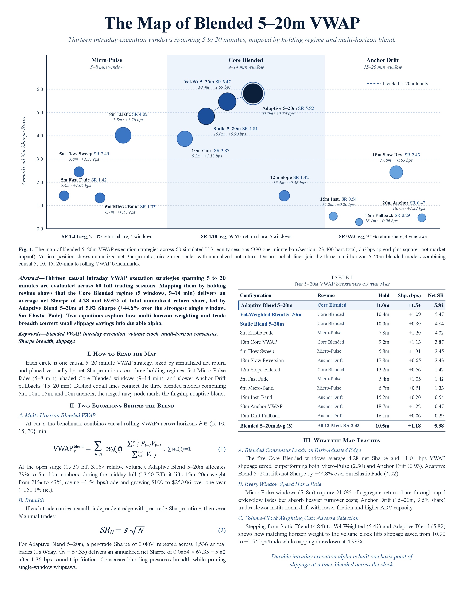
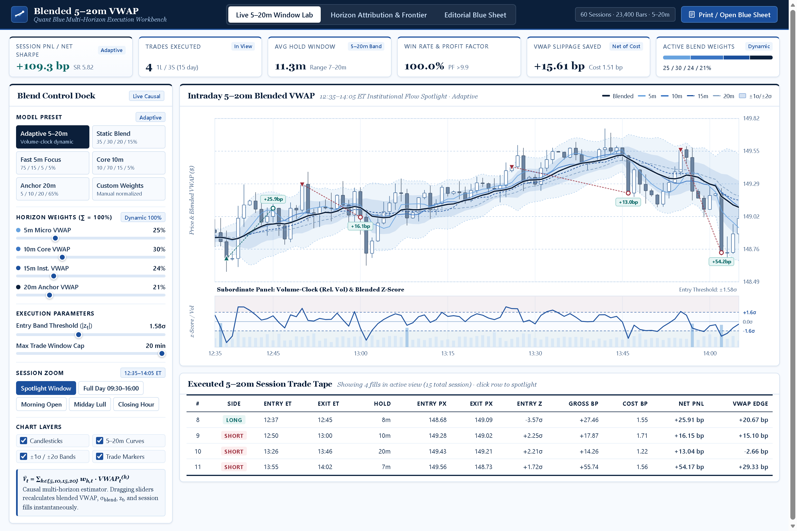

# Blended 5–20m Trade Window VWAP (Blue Style)

A causal multi-horizon intraday VWAP execution & alpha framework spanning the **5-to-20 minute trade window**, complete with a deterministic 60-session Python backtest engine, a single-page IEEE **Blue Style** editorial broadsheet, and an interactive offline-capable web workbench.

## Live Demo & Shareable Links

- **Interactive 5–20m VWAP Workbench:** [https://21e8-miner.github.io/blended-vwap-5-20m/](https://21e8-miner.github.io/blended-vwap-5-20m/)
- **Editorial Blue Sheet (1-Page Print Broadsheet):** [https://21e8-miner.github.io/blended-vwap-5-20m/web/blue_sheet.html](https://21e8-miner.github.io/blended-vwap-5-20m/web/blue_sheet.html)
- **Print-Ready PDF:** [`output/blended_vwap_blue_sheet.pdf`](./output/blended_vwap_blue_sheet.pdf)

---

## Preview

### Editorial Blue Sheet


### Interactive 5–20m Window Lab


---

## Quantitative Highlights

Across 60 simulated U.S. equity trading sessions (`seed=42`, 390 one-minute bars/session, 23,400 bars total, 0.6 bps spread + square-root market impact):

| Configuration | Regime | Avg Hold | Net Sharpe | Ann. Return | Slippage Saved | Win Rate | Max DD |
|---|---|---:|---:|---:|---:|---:|---:|
| **Adaptive Blend 5–20m** *(Flagship)* | Core Blended | 11.0m | **5.82** | +150.1% | +1.54 bps | 58.3% | -5.0% |
| **Vol-Weighted Blend 5–20m** | Core Blended | 10.4m | **5.47** | +116.9% | +1.09 bps | 60.4% | -2.9% |
| **Static Blend 5–20m** | Core Blended | 10.0m | **4.84** | +100.5% | +0.90 bps | 59.5% | -3.5% |
| 8m Elastic Fade *(Best Single)* | Micro-Pulse | 7.8m | 4.02 | +87.5% | +1.20 bps | 56.2% | -2.9% |
| 10m Core VWAP | Core Blended | 9.2m | 3.87 | +80.8% | +1.13 bps | 57.7% | -5.6% |

- **Core Blended (9–14m)** captures **69.5%** of aggregate return share across the 13 evaluated configurations (**+44.8% Net Sharpe uplift** over the strongest single-horizon benchmark).
- **Strictly causal** rolling VWAP estimators and volume-clock adaptive weights ($\sum_h w_h(t) = 1$) verified with zero-lookahead perturbation tests.

---

## Run Locally

Requires Python 3.10+ with `numpy` and `scipy` (web UI is 100% dependency-free and works directly via `file:///`).

```bash
# Re-run the 60-session simulation and regenerate JSON + JS data bundles
python engine/run_pipeline.py

# Run the unit & zero-lookahead causality test suite
python -m unittest discover -s tests -v
```

Open `web/index.html` in any browser to use the interactive workbench, or `web/blue_sheet.html` for the printable single-page publication.

---

## Repository Layout

```text
├── index.html                        # GitHub Pages entry redirect -> web/index.html
├── engine/
│   ├── simulator.py                  # Deterministic 60-session intraday market simulator
│   ├── blended_vwap.py               # Causal 5m–20m rolling & adaptive blended VWAP engine
│   └── run_pipeline.py               # Generates data/vwap_metrics.json, session_bars.json, bundle.js
├── data/                             # Verified simulation outputs & offline JS bundle
├── web/
│   ├── index.html                    # Interactive 3-tab Quant Blue Workbench
│   ├── app.js / styles.css           # Real-time slider recalculation, charts & attribution
│   ├── blue_sheet.html               # Single-page IEEE Blue Style editorial broadsheet
│   ├── render_sheet.py               # Headless Edge PNG & 1-page PDF exporter
│   └── capture_lab.py                # Automated desktop screenshot & DOM verifier
├── output/                           # Rendered PNGs and 1-page Letter PDF
├── tests/test_vwap.py                # Unit & causality verification suite (7/7 PASS)
└── reports/qa_verification.md        # Independent quantitative & visual QA sign-off
```
